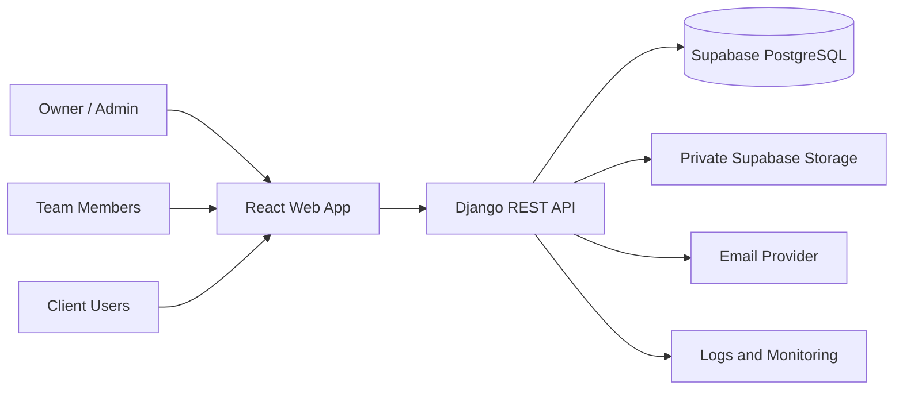
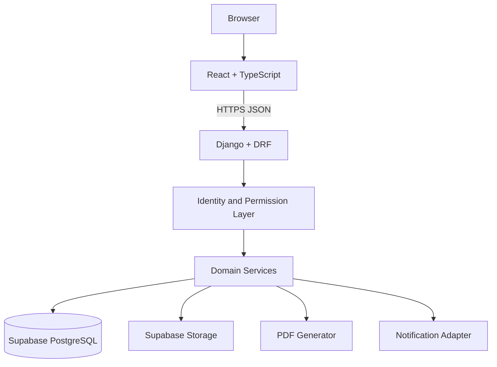

# 3. Software Architecture Document (SAD)

**Version:** 1.0 | **Status:** Proposed baseline

## 3.1 Technology decisions

| Layer | Technology | Status |
|---|---|---|
| Frontend | React + TypeScript | Confirmed |
| Build tool | Vite | Proposed |
| Styling | Tailwind CSS | Proposed |
| Backend | Python + Django | Proposed baseline |
| API | Django REST Framework | Proposed baseline |
| API schema | OpenAPI / Swagger | Proposed |
| Database | Supabase-managed PostgreSQL | Confirmed |
| ORM/migrations | Django ORM and migrations | Proposed |
| Authentication | Django identity + session cookies for the first-party browser | Confirmed for the initial application |
| Storage | Supabase Storage private buckets | Proposed |
| PDF | ReportLab | Proposed |
| Charts | Recharts | Proposed |
| Source control | Git + GitHub | Proposed |
| Deployment | Cloud hosting | Confirmed target; provider open |

## 3.2 System context



## 3.3 Container architecture



## 3.4 Request lifecycle

1. Browser loads the React application.
2. React calls a versioned HTTPS API.
3. Django validates authentication.
4. Permission classes and object-level checks authorize the operation.
5. Serializer validates input.
6. Domain service applies business rules.
7. Django ORM performs database operations.
8. Backend returns a consistent response and safe error messages.
9. Frontend updates UI state and presents feedback.

## 3.5 Backend modular monolith

Recommended Django apps:
- `accounts`: custom user, roles, staff profiles, client identity links.
- `crm`: leads, sources, follow-up activities.
- `clients`: client organizations and contacts.
- `projects`: projects, members, milestones, tasks and updates.
- `documents`: metadata and private storage access.
- `proposals`: proposals, versions and line items.
- `billing`: invoices, invoice items, payments and allocations.
- `finance`: expense categories, expenses and financial summaries.
- `notifications`: in-app and email events.
- `reports`: dashboard aggregates and exports.
- `audit`: audit events.

Start with a modular monolith. Do not introduce microservices until a measured need exists.

## 3.6 Frontend structure

```text
frontend/
  src/
    app/                 # providers, routes, app bootstrap
    components/          # shared UI components
    layouts/             # admin and client layouts
    features/
      auth/
      dashboard/
      crm/
      clients/
      projects/
      proposals/
      billing/
      finance/
      documents/
      client-portal/
      team/
      reports/
    lib/                 # API client and utilities
    hooks/
    types/
    styles/
```

## 3.7 Identity and authentication

Baseline: Django is the single identity and authorization authority. Use Django's custom user model from the first migration. The first-party browser uses Django Session Authentication with HttpOnly cookies and CSRF protection for state-changing requests. Do not store authentication credentials or tokens in localStorage or sessionStorage. JWT is not used unless the owner explicitly approves an architecture change.

Do not enable Supabase Auth in parallel without an explicit architecture change and identity federation design. Avoid two competing user stores.

## 3.8 Database integration

- Django connects to Supabase PostgreSQL using server-side credentials.
- Django ORM owns schema and migrations.
- Never expose `DATABASE_URL`, database password or Supabase service-role key to React.
- Use separate development, staging and production database projects/credentials.
- Use TLS for database connections where supported.
- Review connection pooling and host connection limits.
- Run migrations as a controlled release step, not on every web worker startup.

## 3.9 Storage integration

- Private storage buckets only for client/project documents.
- Database stores object key and metadata, not permanent public URLs.
- Backend checks authorization before creating short-lived signed URLs or streaming files.
- Validate size, MIME type and extension; consider malware scanning for public uploads.
- Keep generated financial PDFs private unless sharing is explicitly authorized.

## 3.10 Deployment topology

Environments:
- Local development.
- Cloud staging with non-production data.
- Cloud production with restricted credentials, HTTPS, backups and monitoring.

Cloud provider is an open decision. Evaluate Django support, region, pricing, logs, managed secrets, backups, database connection compatibility and rollback options.

## 3.11 Architecture quality attributes

- Security: least privilege, server-side access checks, safe secret handling.
- Availability: managed database, health checks, backup and restore.
- Performance: pagination, indexes and query profiling.
- Maintainability: domain boundaries, API schema, typed frontend and tests.
- Portability: reproducible setup and deployment instructions.
