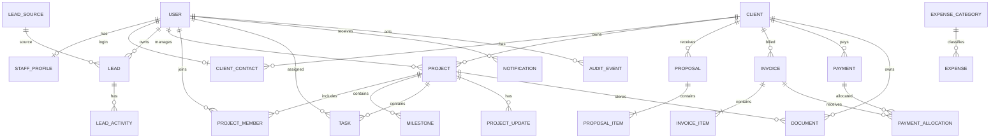

# 4. Database Design and ER Model

**Database:** Supabase-managed PostgreSQL  
**ORM:** Django ORM  
**Status:** Logical proposal; approve before migrations.

## 4.1 ER diagram

## 4.2 Entity catalogue

### Identity
- **User:** UUID, normalized unique email, password hash, active/staff flags, timestamps.
- **Role:** UUID, unique name, description.
- **UserRole:** user FK, role FK, unique pair.
- **StaffProfile:** user FK, display name, phone, job title, active state.
- **ClientContact:** client FK, optional user FK, name, email, phone, primary flag, portal-enabled flag.

### CRM and clients
- **Client:** legal/display name, business type, contact channels, address, status, notes.
- **LeadSource:** source name and active flag.
- **Lead:** source, owner, optional converted client, contact/business details, service interest, stage, next follow-up, notes.
- **LeadActivity:** lead, creator, activity type, description, occurred time.

### Projects
- **Project:** client, manager, name, service type, scope, status, priority, budget, currency, start and due dates.
- **ProjectMember:** project, user, project role.
- **Milestone:** project, name, description, due date, status and completion time.
- **Task:** project, optional milestone, assignee, creator, title, description, status, priority and due date.
- **ProjectUpdate:** project, author, message and client-visible flag.

### Documents
- **Document:** optional client/project, uploader, bucket, storage key, original filename, MIME type, size, visibility and timestamp.

### Proposals and billing
- **Proposal:** client, optional project, unique proposal number, status, currency, totals, valid-until, version and creator.
- **ProposalItem:** proposal, description, quantity, unit, unit price, line total and sort order.
- **Invoice:** client, optional project, unique invoice number, status, currency, dates and totals.
- **InvoiceItem:** invoice, description, quantity, unit, unit price, line total and sort order.
- **Payment:** client, date, amount, currency, method, reference, notes and recorder.
- **PaymentAllocation:** payment, invoice and allocated amount.

### Finance and operations
- **ExpenseCategory:** unique name and active flag.
- **Expense:** category, recorder, vendor, description, amount, currency, date, method and optional receipt document.
- **Notification:** recipient, event type, title, body, related object and read timestamp.
- **AuditEvent:** actor, action, object type/id, safe JSON metadata and timestamp.

## 4.3 Data integrity rules

- Use UUID primary keys for business objects.
- Use `DecimalField` for money.
- Store currency explicitly.
- Use timezone-aware timestamps.
- Use database foreign keys and uniqueness constraints.
- Prevent duplicate invoice/proposal numbers within the approved numbering scope.
- Quantity must be positive; amounts must follow documented sign rules.
- Payment allocation cannot exceed payment amount.
- Total allocations to an invoice cannot exceed its payable balance, except an approved credit/refund process.
- Invoice due date should not precede issue date unless a documented exception exists.
- Preserve immutable snapshots/versions for sent or accepted commercial documents.
- Soft archive operational records where history is required.

## 4.4 Recommended indexes

- Lead: `(stage, owner_id, next_follow_up_at)`
- Project: `(client_id, status, due_date)`
- Task: `(assignee_id, status, due_date)`
- Invoice: `(client_id, status, due_date)`
- Payment: `(client_id, payment_date)`
- Document: `(client_id, project_id, created_at)`
- AuditEvent: `(object_type, object_id, created_at)`

## 4.5 Multi-client isolation

This first release is for one agency, not a public multi-tenant SaaS. Nevertheless, client records must be isolated from one another. Every client-facing query and file access must scope by the authenticated user's linked client organization. Add negative tests for guessed UUIDs and altered object IDs.

## 4.6 Open database decisions

- Currency and multi-currency policy.
- GST/tax fields, rates, inclusive/exclusive behavior and rounding.
- Invoice numbering and financial year.
- Refunds, credit notes and payment reversal.
- Client organization with multiple portal users.
- Retention, deletion and archival rules.
