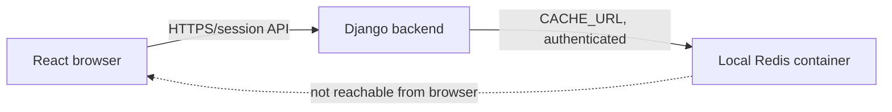

# Loop 010: Local Redis Implementation

**Status:** Local Compose Redis implemented and runtime verified; production Redis remains unconfigured.  
**Date:** 2026-11-02

## Architecture and data flow



The React application does not receive `CACHE_URL` or Redis credentials. The backend uses Django's configured cache API for login throttle counters. When local debug mode has no `CACHE_URL`, settings intentionally use process-local LocMem as a development fallback. When `CACHE_URL` is configured, Django selects `django-redis`. Production still refuses to start without shared TLS Redis using `rediss://`.

## Compose configuration

The development-only Compose file is [compose.redis.yaml](../../compose.redis.yaml). It uses the official `redis:7.4-alpine` image, publishes only `127.0.0.1:6379`, and attaches Redis to a user-defined bridge network used only by this Compose project. The project network isolates Redis from unrelated Compose services. A normal bridge is used instead of Docker's `internal: true` because Docker Desktop did not publish the port from an internal network; the host binding remains strictly loopback-only. Redis has bridge-network egress, so this is not a production network design. It requires a local Docker secret file, generates an ACL file in a 64 KiB container tmpfs with mode `0600`, and removes the password from the bootstrap shell before starting Redis. The password is not embedded in the Compose command or container environment.

Redis is capped at 96 MiB by Compose and 64 MiB by Redis itself. `noeviction` prevents an attacker from silently evicting throttle counters; if the cache cannot accept a counter, the application fails closed with a generic `503`. No named volume is configured. Login-throttle keys are short-lived and disposable, so persistence is unnecessary; counters reset on container recreation/restart.

`.env.redis.example` contains only a safe placeholder. The actual `.env.redis` file is ignored by Git. Generate a strong URL-safe password and store that single value in `.env.redis`; copy the same password into the backend-only `CACHE_URL` in the ignored `backend/.env`. Do not reuse a database password or a production Redis credential.

## Start and stop Redis

Docker Desktop was unavailable during initial inspection; it became available during this loop and was started by the owner/environment. The Redis service is currently running and healthy. Do not start Docker Desktop from an application script.

From the repository root in PowerShell:

```powershell
Copy-Item .env.redis.example .env.redis
```

Edit `.env.redis` and replace the example text with a newly generated URL-safe password. In `backend/.env`, set `CACHE_URL` to `redis://:<same-password>@127.0.0.1:6379/0`. Leave all Redis values out of the frontend environment.

Validate the file and start the development-only service:

```powershell
docker compose -f compose.redis.yaml config --quiet
docker compose -f compose.redis.yaml up -d
docker compose -f compose.redis.yaml ps
```

Check health without displaying the password:

```powershell
docker compose -f compose.redis.yaml exec redis sh -c 'REDISCLI_AUTH="$(cat /run/secrets/redis_password)" redis-cli ping'
```

Expected output is `PONG`; also confirm Compose reports the service as healthy. Stop the service with:

```powershell
docker compose -f compose.redis.yaml down
```

There is no volume to remove, and no application or database data is stored in this container.

## Django cache settings

Backend-only variables:

```dotenv
CACHE_URL=redis://:<same-url-safe-local-password>@127.0.0.1:6379/0
LOGIN_RATE_LIMIT_MAX_ATTEMPTS=5
LOGIN_RATE_LIMIT_WINDOW_SECONDS=900
```

`CACHE_URL` is separate from all `DB_*` settings. Never place it in a `VITE_*` variable. If it is absent while `DJANGO_DEBUG=True`, LocMem remains the explicit offline fallback; this is process-local and is not suitable for distributed throttling. Production requires `rediss://`; there is no production LocMem fallback.

Verify Django cache connectivity from `backend/` after Redis is healthy and `backend/.env` is configured:

```powershell
python manage.py shell -c "from django.core.cache import cache; cache.set('redis-health-check', 'ok', 10); assert cache.get('redis-health-check') == 'ok'; cache.delete('redis-health-check'); print('Django cache is connected')"
```

This verifies a cache round trip and does not print the cache URL or password.

## Tests

Always-runnable cache API and settings tests:

```powershell
cd backend
$env:DB_ENGINE = "sqlite"
$env:DJANGO_DEBUG = "True"
$env:SQLITE_DB_NAME = "dev.sqlite3"
python manage.py test accounts.tests_cache.CacheConfigurationTests accounts.tests_cache.DjangoCacheUnitTests
```

The full backend suite, including auth, CSRF, throttling, audit, and account permissions:

```powershell
python manage.py test accounts api
```

Redis integration tests require the local container and an explicit opt-in. Set `RUN_REDIS_INTEGRATION_TESTS=1` in the current test process after `CACHE_URL` points to loopback Redis:

```powershell
$env:RUN_REDIS_INTEGRATION_TESTS = "1"
python manage.py test accounts.tests_cache.RedisIntegrationTests
```

The integration suite checks Redis `PING`, cache set/get/delete, a throttle counter written from a second Django process, counter expiry, and cache reconnection after forcibly disconnecting the Redis connection pool. Tests use unique keys and delete only their own keys; they never flush Redis. During this loop all four opted-in Redis integration tests passed. The full backend suite passed 36 tests with Redis integration enabled.

The connection-pool recovery test simulates dropped client connections, not an actual Docker service restart. A manual restart was also verified during this loop: the health check returned healthy, the loopback binding remained in place, the disposable probe key disappeared, and a fresh Django process reconnected and completed cache set/get/delete. Cache outage behavior is covered by the existing unit test that simulates cache backend failure; an intentional live outage test was not performed.

## Windows 11 and Docker Desktop troubleshooting

- If `docker version` shows a client but no server, start Docker Desktop manually and wait for its Linux engine. This loop does not start it automatically.
- Confirm `wsl --status` reports default version 2 and `wsl --list --verbose` shows Docker's WSL distribution running after Docker Desktop starts.
- If port 6379 is occupied, do not change the Compose bind to `0.0.0.0`. Stop the conflicting local service or request approval for a different loopback port and matching backend URL.
- If Compose reports the password secret is missing, verify `.env.redis` exists at the repository root and contains only the local password; do not print it.
- If Django returns the existing generic cache-unavailable `503`, check Compose health, the port binding, the matching password in backend `CACHE_URL`, and whether the password contains URL-reserved characters. Prefer a URL-safe generated password.
- If a developer uses WSL-hosted Django instead of Windows-hosted Django, validate host-to-container loopback routing explicitly before changing `CACHE_URL`; do not widen the published host binding.

## Production Redis requirements

Local Compose is not a production topology. Production requires a shared Redis-compatible service with `rediss://` TLS and certificate validation, authentication, private network restrictions, managed secret delivery and rotation, connection/memory limits, monitoring and recovery alerts. Use separate instances/credentials for development, staging and production. Configure trusted proxy handling before relying on remote IP throttling. Do not claim production-grade distributed throttling until a real production-like shared Redis service and cross-process tests pass.

## Verification state and remaining risks

- Docker CLI and Compose are installed. Docker Desktop is now responding. WSL2 version 2 is available.
- Compose syntax validation passed. Redis is currently running and healthy at `127.0.0.1:6379`; authenticated `PING` returned `PONG`.
- The ignored `.env.redis` file was generated locally and is not committed. The real `backend/.env` was not modified; until its backend-only `CACHE_URL` is configured, ordinary Django starts continue to use LocMem.
- No dependencies were added or upgraded. The existing `django-redis` and `redis-py` dependencies are reused.
- No migration command, Supabase operation, `test_postgres` operation, or `backend/db.sqlite3` write is part of this loop.
- The local ACL grants the authenticated default Redis user access to all keys/commands on this isolated development-only instance. Do not expose it beyond loopback or reuse its credential elsewhere.